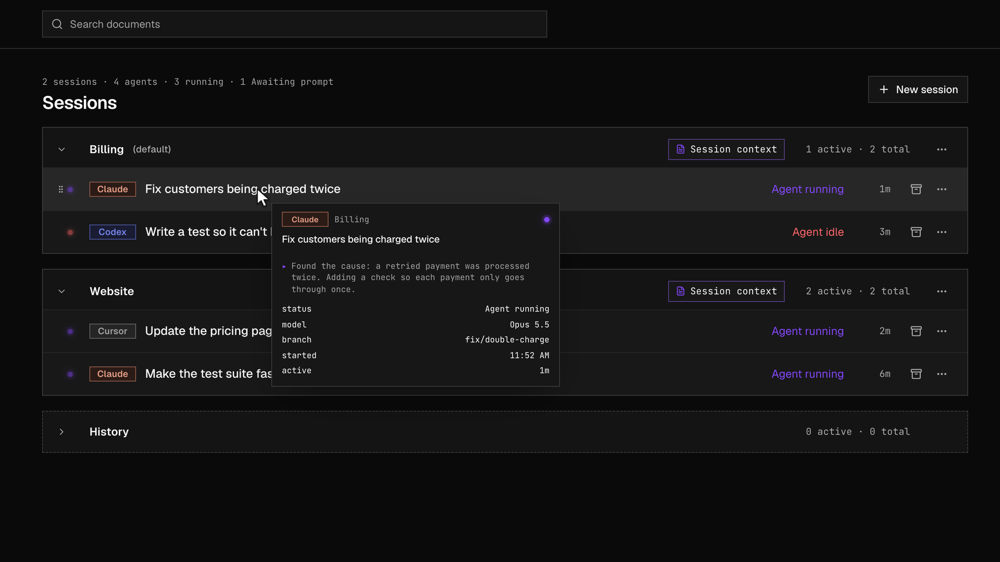
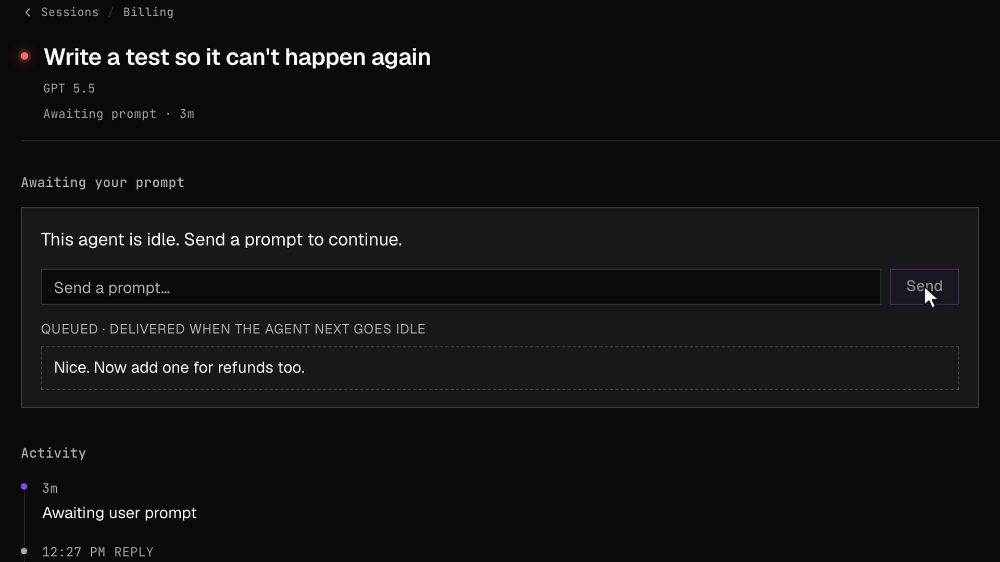
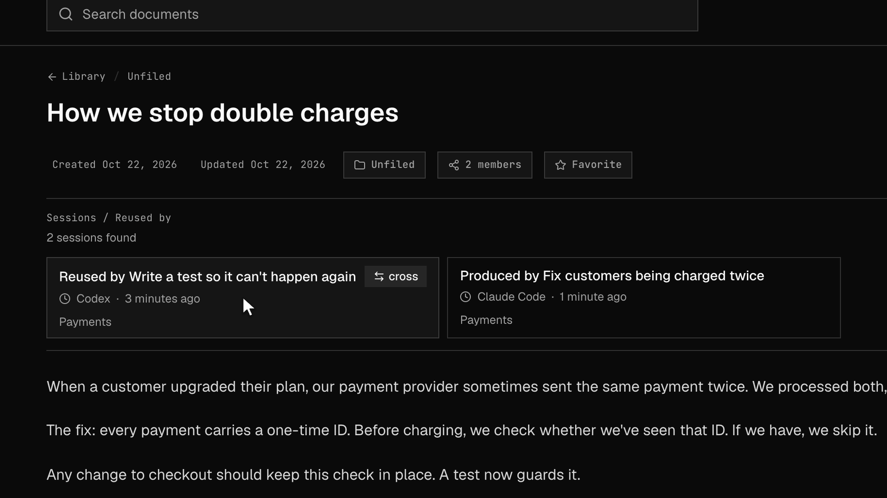

# Taskforce

**Mission control for your AI coding agents.**

Your team runs AI agents in Claude Code, Codex and Cursor. Taskforce puts them all in one place, lets you steer them, and keeps what they learn so the next agent starts ahead.

### See every agent your team is running

### Send a waiting agent a message

It picks up your note on its next step.

### Keep what agents learn

Fixes become short notes the whole team can search, so the next agent, in any tool, starts from there.

Screenshots show sample data.

---

**Try it:** [taskforce.tools](https://www.taskforce.tools) · [Quickstart](docs/user-guide/01-quickstart.md) · [User guide](docs/user-guide/README.md)

**This repo** is the backend: the API (`demo/full-stack-fastapi-template/backend`), the hosted MCP server (`mcp/`), the agent hooks for Claude Code, Codex and Cursor (`scripts/`), and the product docs (`docs/`). The web app lives in [EnderAI-frontend](https://github.com/al-exe/EnderAI-frontend).
