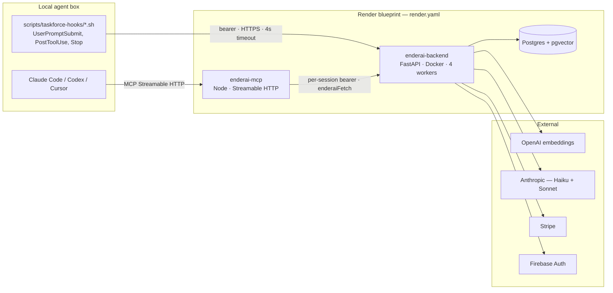
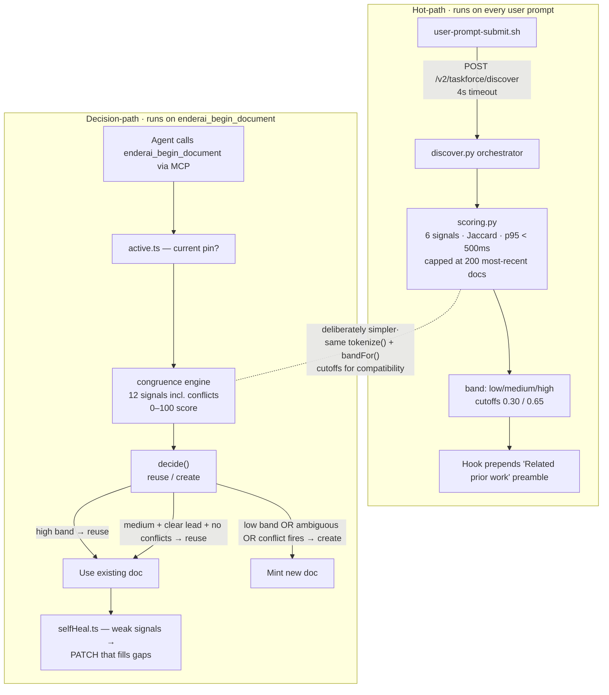
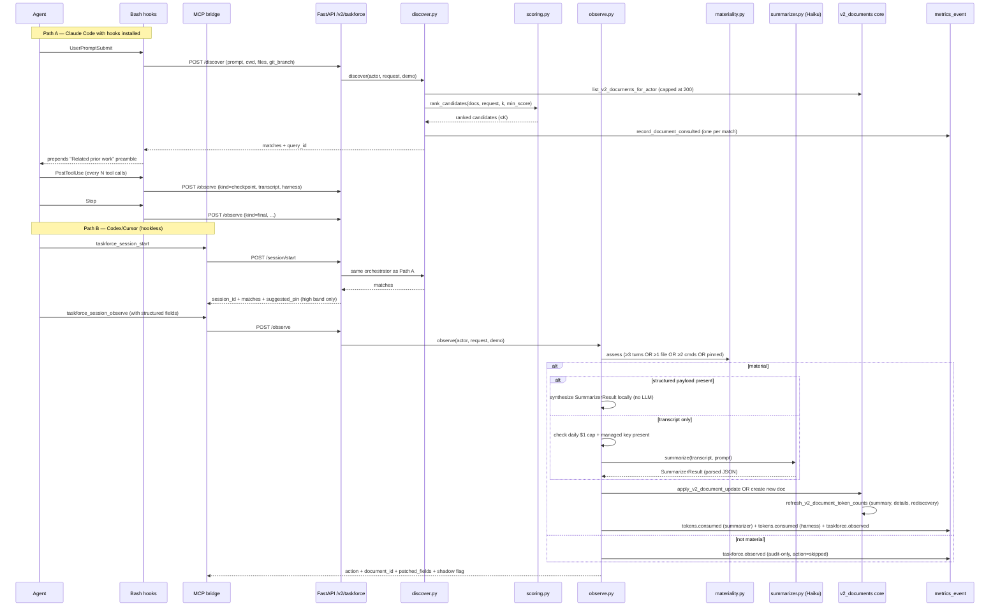
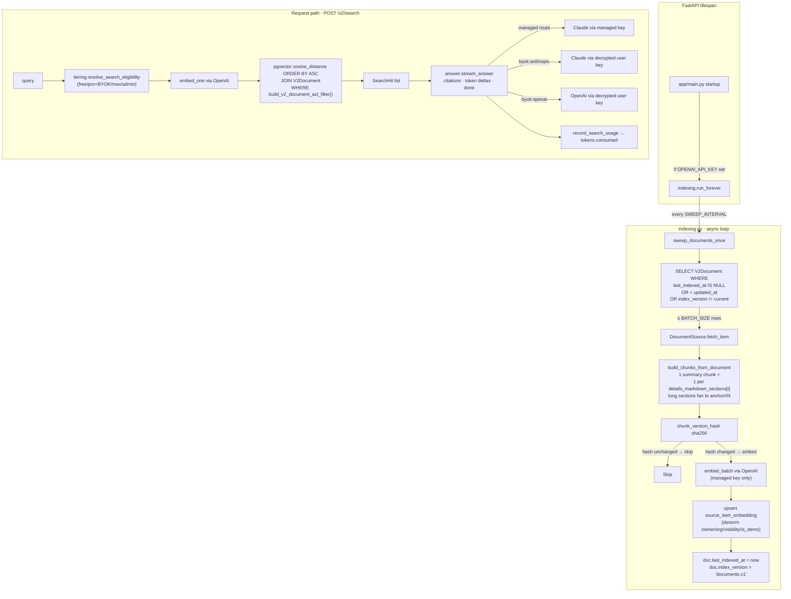
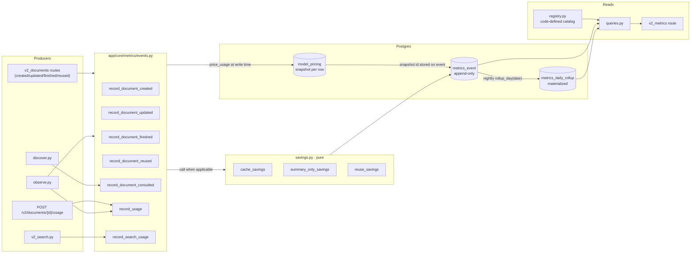
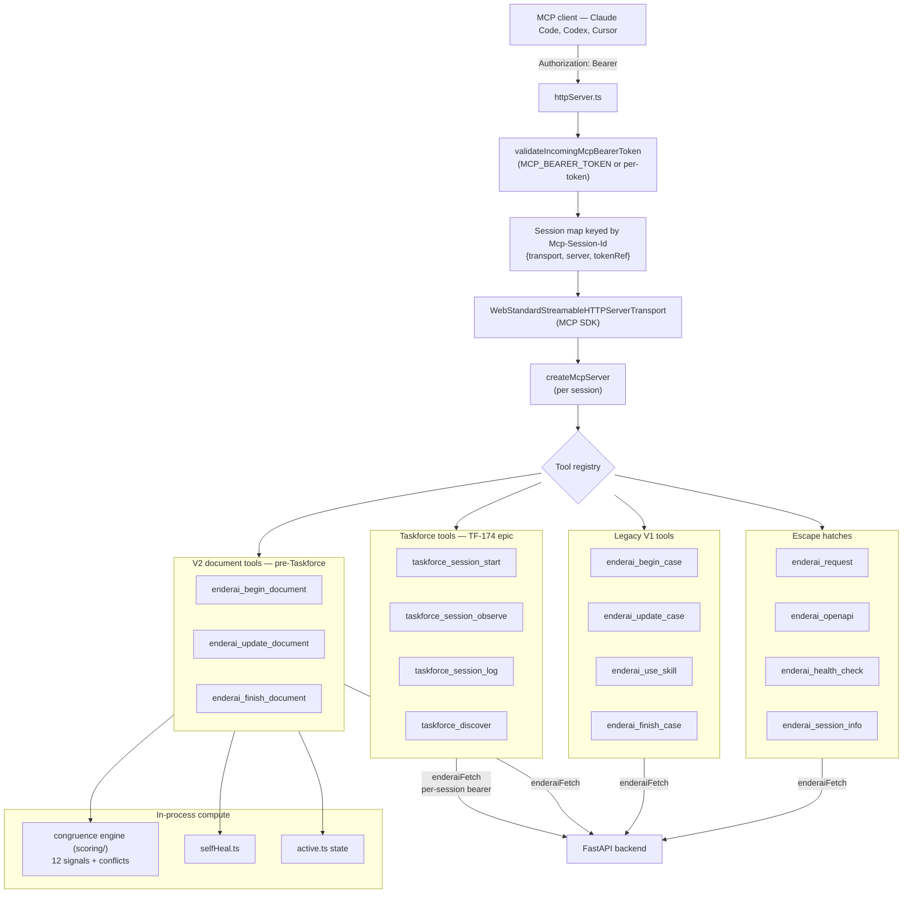
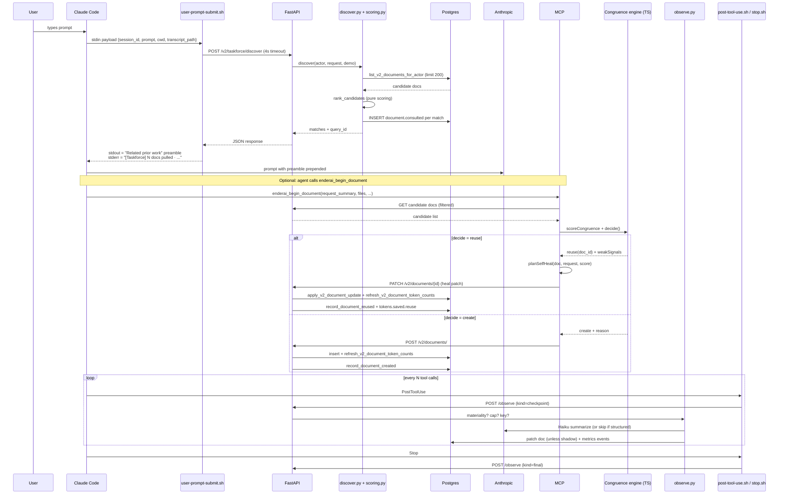

# Taskforce Backend Architecture — Microservice Shape

Last updated: 2026-05-23
Author: Claude (independent pass; companion to `taskforce-backend-architecture-overview.md` from Codex)

Scope of this doc: how the backend is *partitioned* into services and sub-services, where decisions actually run, and how the scoring engine connects to the rest of the system. Auth, identity, billing, and the legacy V1 Topic/Case path are deliberately out of scope — see Codex's doc for those.

The big surprise vs. the Codex writeup: **there are two scoring engines**, not one. They live in different runtimes, run on different paths, and answer different questions. Most of this document is about that split and how it propagates outward.

## 1. Deployment view — what's actually a service

The Render blueprint declares **two web services**: `enderai-backend` (Python/FastAPI) and `enderai-mcp` (Node/TS). Nothing else runs out-of-process. There is no Redis, no Celery/arq, no separate scoring service, no embeddings worker, no rollup cron container.

Everything that *looks* like a microservice — the scoring engine, search indexer, summarizer, metrics rollup — runs **inside the FastAPI process** or **inside the MCP process**. They are sub-services by module boundary, not deployment boundary.

The local hooks are the third runtime, but they live on the user's laptop. They're shell scripts that POST to the backend with the user's per-machine bearer token; the backend treats them indistinguishably from a browser session.

## 2. Service inventory by module

Everything below is a logical service. Co-located in one of the two processes.

| Service | Process | Path | Lines | What it owns |
|---|---|---|---|---|
| **Discovery scorer (fast)** | backend | `app/core/taskforce/scoring.py` | 275 | 6-signal Jaccard ranker, p95 < 500ms |
| **Discovery orchestrator** | backend | `app/core/taskforce/discover.py` | 202 | ACL fetch → score → emit consult events |
| **Session entry** | backend | `app/core/taskforce/session.py` | 71 | Mints `session_id`, runs discover, picks `suggested_pin` |
| **Observe orchestrator** | backend | `app/core/taskforce/observe.py` | 504 | Materiality → summarize *or* structured → patch doc → emit metrics |
| **Materiality gate** | backend | `app/core/taskforce/materiality.py` | 74 | Pure decision: is this session worth Haiku money? |
| **Summarizer** | backend | `app/core/taskforce/summarizer.py` | 211 | Async Haiku call with redacted transcript |
| **Redaction** | backend | `app/core/taskforce/redaction.py` | 83 | Pre-summarizer secret scrub |
| **Rediscovery cost** | backend | `app/core/taskforce/rediscovery.py` | 139 | Pure structural estimator, cached on doc |
| **Search indexer** | backend | `app/core/search/indexing.py` | 268 | Lifespan asyncio task; drift-sweep loop |
| **Search retrieval** | backend | `app/core/search/retrieval.py` | 93 | pgvector cosine + ACL join |
| **Search answer** | backend | `app/core/search/answer.py` | 234 | SSE stream; managed Claude or BYOK Claude/OpenAI |
| **Embeddings client** | backend | `app/core/search/embeddings.py` | 100 | Managed OpenAI key; lazy import |
| **Document connectors** | backend | `app/core/search/connectors/` | ~170 | `Source` protocol; only `DocumentSource` is real |
| **Metrics emitters** | backend | `app/core/metrics/events.py` | 509 | Append-only event writes; pricing snapshot per write |
| **Savings calculators** | backend | `app/core/metrics/savings.py` | 123 | Three sources: cache, summary-only, reuse |
| **Metrics registry** | backend | `app/core/metrics/registry.py` | 206 | Code-defined metric catalog |
| **Metrics rollup** | backend | `app/core/metrics/rollup.py` | 151 | Daily materialization to `metrics_daily_rollup` |
| **Metrics queries** | backend | `app/core/metrics/queries.py` | 335 | Read-side aggregations + windowing |
| **Document ACL/access** | backend | `app/core/v2_documents.py` | ~2200 | `build_v2_document_acl_filter`, token-count refresh |
| **Congruence engine (smart)** | MCP | `mcp/src/v2Documents/scoring/` | ~870 | 12-signal weighted engine w/ conflicts; reuse-or-create decision |
| **Self-heal planner** | MCP | `mcp/src/v2Documents/selfHeal.ts` | 248 | Builds PATCH from weak-signal gaps + new request |
| **Active doc state** | MCP | `mcp/src/v2Documents/active.ts` | 35 | Per-session pin tracking |
| **MCP tool registry** | MCP | `mcp/src/mcpServer.ts` | 2780 | All tool definitions and dispatch |
| **MCP HTTP transport** | MCP | `mcp/src/httpServer.ts` | 306 | Streamable HTTP server, session map, bearer binding |

## 3. The two scoring engines

This is the architectural point that matters most and that Codex's doc glossed over.

### 3.1 Python scorer — `app/core/taskforce/scoring.py`

| Property | Value |
|---|---|
| Runtime | Backend FastAPI process |
| Caller | `discover.py`, which is called by the hook (HTTP) or the MCP `taskforce_discover` fallback |
| Latency budget | p95 < 500ms across 200 candidates |
| Signals | title-overlap, corpus-overlap, file-substring, symbol-substring, error-substring, recency (exp decay, 30d half-life) |
| Weights | `title 0.30, corpus 0.25, files 0.15, recency 0.15, symbols 0.10, errors 0.05` |
| Score range | `[0, 1]` |
| Bands | low < 0.30, medium < 0.65, high ≥ 0.65 |
| Output | `rank top-K above min_score` — for the preamble |
| What it can't do | Conflict signals, anti-matches, embeddings, collaborators, intent phrases |
| Purity | Pure: `score_document(doc, request) → ScoredCandidate`. No I/O. |

It exists to feed the **UserPromptSubmit hook**, which is on the critical path of every user keystroke. The hook has a hardcoded 4-second curl timeout and runs synchronously before Claude Code sees the prompt. So this scorer is optimized for *predictable, bounded latency*, not for *best possible ranking*.

### 3.2 TypeScript congruence engine — `mcp/src/v2Documents/scoring/`

| Property | Value |
|---|---|
| Runtime | MCP Node process |
| Caller | `enderai_begin_document` tool — the explicit, agent-driven decision |
| Latency budget | Single tool call; ~hundreds of ms is fine |
| Signals (positive) | title-overlap, file-overlap, symbol-overlap, error-overlap, anchor-overlap, collaborator-overlap, recency, intent-phrase ("continue", "follow-up", "still", …) |
| Signals (conflict) | tenant-conflict, repo-conflict, error-family-conflict, terminal-state-conflict |
| Weights | Positives sum to 100; conflicts are negative (`tenant: -60, repo: -30, error-family: -25, terminal: -25`) |
| Score range | `[0, 100]` (after clamp) |
| Bands | low < 45, medium < 70, high ≥ 70 |
| Output | `decide() → reuse(doc_id) | create` — a *decision*, not a ranking |
| Self-heal hook | Yes: `weakSignals` (positive signals that fired weakly) drive `selfHeal.ts` to plan a PATCH that fills the gaps |
| Purity | Pure: `scoreCongruence(candidate, request, config)`. No I/O. |

The conflict signals are the killer feature. Even a strong title match gets rejected if the doc mentions tenant `acme` and the request mentions tenant `globex`. Even a high-scoring candidate gets rejected if the doc has `## Outcome` (or any `terminal-state` marker) and the request doesn't read as a continuation. These exist because the cost of incorrectly reusing a closed/done/wrong-tenant doc is much higher than the cost of creating one extra fresh doc.

### 3.3 Why the split, and where it leaks

Both engines share `tokenize()` semantics (same stopwords, same `\p{L}\p{N}_./-` split) and the same `bandFor` cutoff *philosophy* (low/medium/high naming). That's intentional — the Python file's docstring explicitly says it mirrors the TS so divergence stays bounded to *which* signals fire, not *how* tokens are extracted.

But the band cutoffs themselves are different (`0.30/0.65` vs `45/70`), the scales are different, and the conflict signals only exist in one. So:

- A doc that the **fast scorer** ranks `0.72 high` may or may not survive the **smart engine**'s conflict checks.
- The hook will surface that doc to the user as "Related prior work" anyway, because the hook doesn't run the smart engine.
- If the agent then calls `enderai_begin_document` on the same context, the smart engine may decline to reuse — and silently mint a fresh doc.

This is fine for now (discover is a *suggestion*, begin is a *decision*) but it's an actual semantic gap, not a phase-1/phase-2 distinction. Worth documenting somewhere visible.

## 4. Taskforce session pipeline (V2 lifecycle)

### Key facts the Codex doc undersold

1. **Two material entry points: hooks and MCP.** They share the same backend orchestrator (`discover.py`, `observe.py`). The MCP path is not "legacy fallback"; it's the only path Codex/Cursor have, and `session_start` (TF-181) is recent.

2. **Shadow mode is opt-out**, not opt-in. `TASKFORCE_OBSERVE_SHADOW` defaults to `1`. So in production today, `/observe` records the audit event and computes the diff but **does not patch the doc**. Flipping that requires a deploy env-var change.

3. **The structured-payload shortcut** (`_has_structured_payload`) is a quiet but important cost lever. If the agent provides `summary_points`/`details_sections`/`decisions`/`outcome` directly, the backend bypasses both the Haiku call *and* the daily $1 cap *and* the managed-key requirement. This is what makes the hookless MCP path viable for users without the managed Anthropic key.

4. **Daily USD cap** ($1/user/day for summarizer) is the only meaningful cost control. It only gates the Haiku call, not the harness `tokens.consumed` event (which is just accounting).

5. **Materiality is deterministic and runs before any LLM call.** ≥3 assistant/tool turns, OR ≥1 file modified, OR ≥2 distinct shell commands, OR `active_document_id` is set. If none of those, the audit row says `skipped: trivial_session` and no money is spent.

## 5. Search subsystem — how the pieces wire up

### Architectural notes the file structure makes obvious

- **`connectors/base.py` defines a `Source` Protocol** with `list_items`, `fetch_item`, `handle_event`. Only `DocumentSource` is wired. There's a `stub_slack.py` placeholder. The connector interface includes a webhook entrypoint, which is dead code today but means adding Slack/GitHub/Gmail wouldn't require reshaping the indexer — only writing a new Source.

- **The indexer is a single asyncio task in the FastAPI process.** No locking, no leader election. The file's own comment flags this as the next thing to fix when the backend goes multi-instance: wrap `sweep_documents_once` in a Postgres advisory lock.

- **ACL is double-enforced.** The `source_item_embedding` row carries denormalized `owner_id`/`organization_id`/`visibility`/`is_demo`. The query also JOINs back to `V2Document` and applies the *same* `build_v2_document_acl_filter` used by the read API. The denorm columns are belt-and-suspenders; the JOIN is the actual gate. This means a doc's ACL can change without re-indexing — the next retrieval picks up the new ACL from the V2Document row.

- **Embeddings are always managed key, even for BYOK users.** This is a hard design call called out in `embeddings.py`: BYOK affects only the *answer* call, never the *index*. Otherwise you'd end up with two embedding spaces and unusable retrieval.

- **Long details sections fan out to `<anchor>#N` chunks** (per `MAX_CHUNK_CHARS=2000`), preserving the anchor-link semantics that Summary segments use via `evidence_anchor_id`. So a search hit on `setup#3` still maps back to the same anchor a Summary paragraph would cite.

- **No FTS, no hybrid.** Phase 1 is vector-only. The `retrieval.py` header explicitly contracts: the `SearchHit` shape won't change when FTS lands.

## 6. Metrics architecture — event-sourced with code-defined registry

### What's distinctive about this design

1. **Pricing is snapshotted at write time.** Each `metrics_event` row stores `pricing_id` referencing the `model_pricing` row that was effective at `occurred_at`. So when Anthropic raises Sonnet prices in three months, the historical USD totals on yesterday's events don't move. The plan calls this out as a hard requirement.

2. **The metric *catalog* is code, not data.** `registry.py` is the source of truth. Adding `documents_consulted` was one PR that appended a `MetricDefinition`; both the rollup job and the read API pick it up by iterating the registry. The frontend self-describes via `GET /v2/metrics/definitions`.

3. **Composed metrics defer until read time.** `reuse_rate` and `documents_touched` set `composed=True` and aren't materialized in `metrics_daily_rollup`. They're computed from underlying counts when the read endpoint asks for them. The rollup job skips them via `rollup_metric_names()`.

4. **`document.consulted` smuggles savings through `input_tokens`.** `discover.py` records the consult event with `input_tokens = max(0, rediscovery_cost - summary_tokens_read)`. The `avoided_rediscovery` metric definition then aggregates that field. This is a deliberate choice to avoid a "savings_tokens" column or a per-metric JSONB parse — the registry says "sum input_tokens for kind=document.consulted" and it just works.

5. **Rediscovery cost is cached on the document, not computed at consult time.** `refresh_v2_document_token_counts` runs on every doc mutation (`apply_v2_document_update`) and writes `summary_tokens`, `details_tokens`, `rediscovery_cost_tokens` directly onto the row. Discover reads them with a plain attribute access. So discover stays fast even when the doc is complex.

6. **Demo and live data are rolled up as separate rows.** `is_demo` is part of the rollup primary key tuple. Plan §11 demanded strict isolation — this is how it's enforced.

7. **Five-way `record_*` taxonomy + one cross-cutting `_record_usage_events`.** Every `record_document_*` function takes an optional `TaskforceUsagePayload` and, when present, also writes the paired `tokens.consumed` + `tokens.saved.*` events. So the document lifecycle event and its cost event always commit together (single transaction, caller commits).

## 7. MCP bridge — what it actually is

### MCP bridge responsibilities, precisely

The MCP bridge is **not** a service tier. It's a:

1. **Protocol adapter** — translates MCP Streamable HTTP ↔ JSON REST. `enderaiFetch()` is a thin authenticated `fetch` wrapper.
2. **Per-session token holder** — when the client sends a bearer on initialize, the bridge binds it to the session's `tokenRef` and forwards it on every subsequent backend call. Token rotation mid-session is supported (the `tokenRef` getter is mutable).
3. **In-process decision engine** — `enderai_begin_document` runs the 12-signal congruence engine *locally* in the Node process before deciding to call the backend's create vs. PATCH route. This is why the smart engine lives in TypeScript: it's a tool-side decision, not a backend service.
4. **Self-heal planner** — when reuse fires, `selfHeal.ts` plans a PATCH from the doc's weak signals + the new request, also locally in Node. The backend just applies the PATCH it receives.

`mcpServer.ts` is 2780 lines because it registers every tool's schema and dispatches. The actual business logic is in `v2Documents/` and `taskforce/`.

### What's notably absent from the MCP bridge

- No database. Ever. All persistence flows through the backend.
- No LLM calls. All Anthropic/OpenAI traffic is backend-side.
- No caching beyond the per-session active-document state (in `active.ts`, a single `{documentId, title, startedAt, lastUpdatedAt, demo}` object).
- No metrics emission. The backend writes events; the MCP doesn't have a DB connection.

If the MCP process restarts, you lose only the in-flight Streamable HTTP sessions. No durable state is at risk.

## 8. Cross-cutting wiring — how it all connects on one prompt

End-to-end trace for one user prompt in Claude Code with hooks installed:

Note that the two scoring engines are on different branches of this trace. The hook always runs the fast Python scorer. The smart TS engine only runs if the agent explicitly invokes `enderai_begin_document`.

## 9. Runtime risks and design seams worth knowing

These are things the code calls out explicitly or that fall out of the architecture:

- **Indexer single-instance.** `run_forever()` is a lifespan asyncio task. Two backend instances will both sweep the same drift. The comment in `indexing.py` already names the fix: Postgres advisory lock. Not yet implemented.
- **Two scoring engines, no parity tests.** Both copy the `tokenize()` semantics and `bandFor` cutoff *names*, but there's no test that asserts they produce comparable bands on shared inputs. A doc that reads "high" to the hook may read "low" or "create-fresh" to the begin-document path.
- **Shadow mode is the production default.** Operationally, `/observe` is auditing intent — not mutating documents. Anything that looks at "did the doc get updated by the agent?" needs to check `TASKFORCE_OBSERVE_SHADOW`. Codex's doc mentions this; it's worth re-stating because it changes what the metrics actually mean.
- **Materiality + daily cap are the only safety rails on summarizer spend.** Both are cheap to bypass accidentally (e.g. a runaway harness reporting `active_document_id` on every prompt would mark every session material). Worth monitoring `tokens.consumed.subkind=taskforce_summarizer` per-user.
- **Rediscovery cost is cached only when the doc mutates.** A doc whose structure was estimated under v1 coefficients will stay v1 forever unless someone bumps it. There's no migration step here yet.
- **MCP `enderai_request` is an escape hatch into the full backend API.** It's how agents call arbitrary OpenAPI routes through the bridge. Security-wise this is bounded by the per-session bearer (i.e. the user's own permissions), but it does mean the MCP surface includes anything the backend exposes.
- **Embedding space is locked to one model.** `settings.SEARCH_EMBEDDING_MODEL` (`text-embedding-3-small`, 1536d) is what the entire `source_item_embedding` table assumes. Changing it requires a full reindex driven by bumping `CURRENT_INDEX_VERSION`.

## 10. Reading order for the curious

If you want to internalize this system, read in this order:

1. `app/core/taskforce/scoring.py` — 275 lines, pure, no dependencies.
2. `mcp/src/v2Documents/scoring/signals.ts` — 619 lines but cleanly split per signal. Compare and contrast with #1.
3. `mcp/src/v2Documents/scoring/engine.ts` + `config.ts` — see how weights + `decide()` compose.
4. `app/core/taskforce/discover.py` — the thin orchestrator. Ties scoring to ACL + metrics.
5. `app/core/taskforce/observe.py` — the meaty one. Shadow mode, structured shortcut, daily cap, summarizer dispatch.
6. `app/core/search/indexing.py` — the only thing in this codebase that runs a background loop.
7. `app/core/search/retrieval.py` — short. Shows the ACL JOIN pattern.
8. `app/core/metrics/events.py` + `savings.py` + `registry.py` — read together. Three files, one design.
9. `mcp/src/httpServer.ts` — see how thin the MCP transport layer actually is.
10. `scripts/taskforce-hooks/user-prompt-submit.sh` — read this last; it's the *real* discover client.
