# Taskforce Backend Architecture Overview

Last updated: 2026-05-24

Taskforce, previously EnderAI, is a backend-centered agent memory and retrieval system. The current backend source of truth is the `taskforce-claude` checkout, with most Python code under `demo/full-stack-fastapi-template/backend` and the hosted MCP bridge under `mcp/enderai-api-mcp`. A lot of code, routes, package names, and environment variables still use `EnderAI` / `enderai` names; treat those as legacy naming, not a separate product surface.

This document focuses on the backend runtime: FastAPI, Postgres, the hosted MCP bridge, V2 documents, Taskforce discovery/observation, search, metrics, billing, and the legacy Topic/Case model.

## System Context

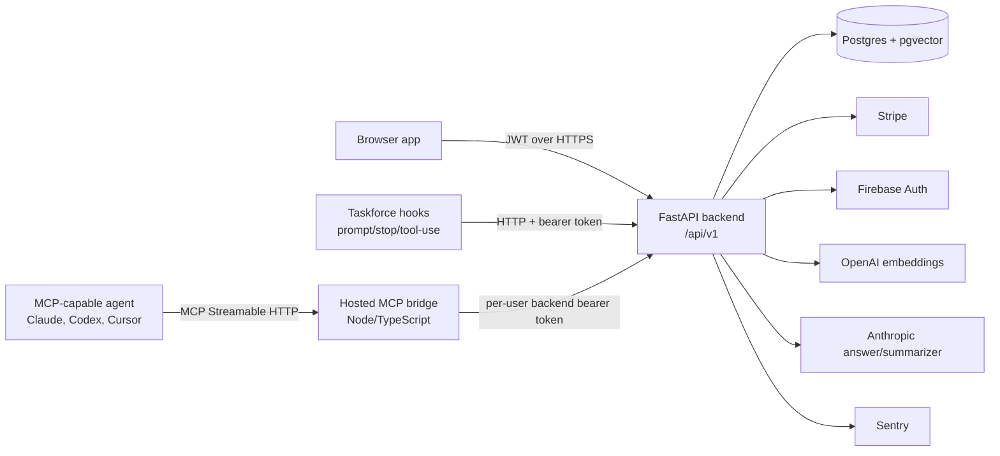

The browser, hooks, and MCP tools converge on the same FastAPI API and the same Postgres database. The MCP service is a workflow bridge and session adapter; it is not a source of truth.

## Runtime Topology

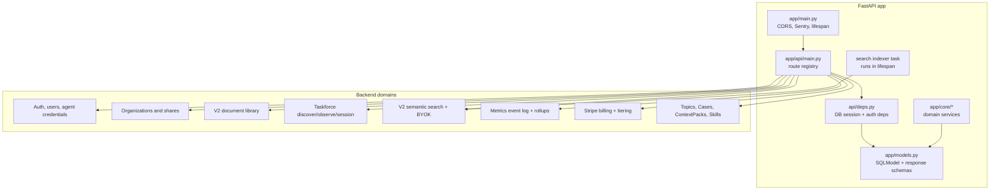

Key runtime files:

- `app/main.py`: creates the FastAPI app, installs CORS, enables Sentry outside local, and starts the async search indexer when `OPENAI_API_KEY` is configured.
- `app/api/main.py`: mounts every route group under `settings.API_V1_STR`, currently `/api/v1`.
- `app/api/deps.py`: opens SQLModel sessions and resolves current users from normal JWTs or agent credential JWTs.
- `app/models.py`: central SQLModel table definitions plus public request/response shapes.
- `app/core/*`: domain logic for documents, metrics, search, Taskforce hooks, billing, auth, and legacy Topic/Case behavior.

## Deployment Shape

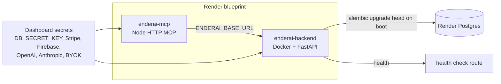

The Render blueprint in `taskforce-claude/render.yaml` defines two web services:

- `enderai-backend`: Docker runtime rooted at `demo/full-stack-fastapi-template/backend`; the container runs `alembic upgrade head` and then `fastapi run --workers 4 app/main.py`.
- `enderai-mcp`: Node runtime rooted at `mcp/enderai-api-mcp`; builds TypeScript and serves Streamable HTTP MCP at `/mcp`.

The database is Postgres with `pgvector` enabled for the V2 Search embedding index.

## Auth And Identity

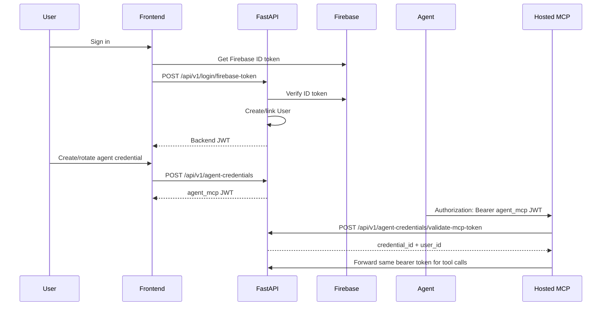

The backend supports two human auth modes:

- Firebase is preferred in production: `/login/firebase-token` exchanges a Firebase ID token for the backend JWT.
- Password auth remains available when Firebase is not configured: `/login/access-token`, password recovery, and reset-password routes.

Agent credentials are backend JWTs with `token_kind="agent_mcp"` and a credential id/version. Revoking or rotating an `AgentCredential` invalidates older agent tokens because validation checks the stored `token_version` and `revoked_at`.

## Core Data Model

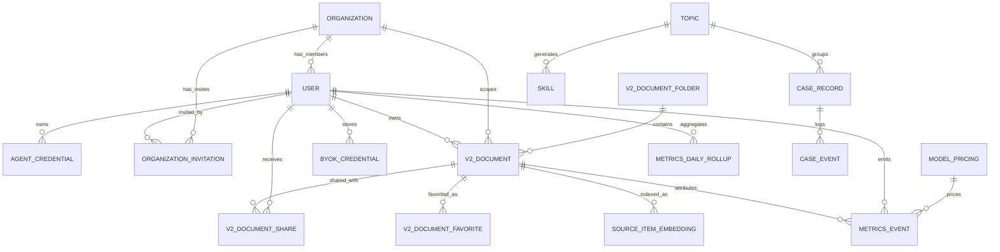

Most active Taskforce behavior is centered on `V2Document`, `MetricsEvent`, and `SourceItemEmbedding`. The legacy `Topic` / `CaseRecord` / `CaseEvent` / `Skill` model still exists for V1 workflows and backwards-compatible MCP tools.

## V2 Document Library

V2 documents are the primary durable artifact for Taskforce. A document stores:

- ownership and ACL fields: `owner_id`, `organization_id`, `visibility`, explicit shares, folders, favorites, and demo isolation.
- human and agent fields: `human_summary`, `ai_generated_summary`, `main_body`, and `details_markdown_sections`.
- evidence structure: `main_body` paragraphs have segments that can point at Details anchors via `evidence_anchor_id`.
- accounting fields: `summary_tokens`, `details_tokens`, and `rediscovery_cost_tokens`.
- search drift markers: `last_indexed_at` and `index_version`.

Access is centralized in `app/core/v2_documents.py`:

- `build_v2_document_acl_filter()` defines readable documents for owner, explicit share, organization visibility, and demo mode.
- `resolve_v2_document_access()` returns `owner`, `editor`, `viewer`, or no access.
- `can_update_v2_document()` allows owners and editors to patch content.
- `refresh_v2_document_token_counts()` recomputes token estimates and rediscovery cost after document mutation.

The document API lives under `/api/v1/v2/documents` and covers CRUD, folders, shares, favorites, usage events, and reuse events.

## Taskforce Agent Lifecycle

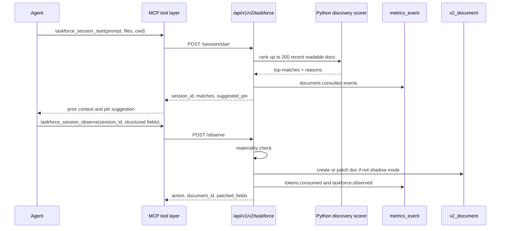

There are now two Taskforce-facing layers:

- Hook-driven HTTP endpoints under `/api/v1/v2/taskforce`: `discover`, `session/start`, `observe`, and `session-log`.
- MCP fallback / hookless tools: `taskforce_session_start`, `taskforce_session_observe`, `taskforce_session_log`, and `taskforce_discover`.

`taskforce_session_start` is the newer hookless entry point. It mints a `session_id`, runs discovery, and returns a `suggested_pin` when the top match is high confidence. `taskforce_session_observe` sends final or checkpoint observations back to the backend. When structured fields are supplied, the backend skips the Haiku summarizer and directly builds the document patch.

Observation defaults to shadow mode unless `TASKFORCE_OBSERVE_SHADOW=0`, so the backend can audit intent and metrics before allowing automatic document mutation.

## Discovery And Rediscovery Savings

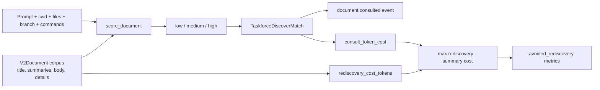

The hook discovery scorer in `app/core/taskforce/scoring.py` is intentionally simpler than the MCP TypeScript congruence engine. It optimizes for frequent prompt-time use:

- title overlap
- corpus token overlap
- file, symbol, and error substring matches
- exponential recency decay

It returns scores in `[0, 1]` with bands: low `< 0.30`, medium `< 0.65`, high otherwise.

Rediscovery cost is a structural estimate computed from document content:

- commands
- files referenced
- decisions
- Details sections
- Summary points

The estimate is capped at 50,000 tokens per document. Each consultation records `net_saved_tokens = max(0, rediscovery_cost_tokens - consult_token_cost)` into `metrics_event.input_tokens`, which drives the avoided-rediscovery metrics.

## Semantic Search

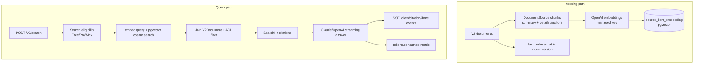

Search uses a connector-style indexing pipeline. Phase 1 only indexes V2 documents:

- The FastAPI lifespan starts `app.core.search.indexing.run_forever()` when `OPENAI_API_KEY` is present.
- The indexer finds documents whose `last_indexed_at` is missing/stale or whose `index_version` changed.
- `DocumentSource` builds one synthetic summary chunk plus one or more Details-anchor chunks.
- Chunks are embedded with the managed OpenAI key and written to `source_item_embedding`.
- Retrieval embeds the query, searches pgvector by cosine distance, then joins back to `v2_document` and applies `build_v2_document_acl_filter()`.

Search answer generation is tier gated:

- Free: not allowed.
- Pro: allowed only with active BYOK; routes to `byok:anthropic` or `byok:openai`.
- Max/Admin: uses the managed Anthropic key.

The answer endpoint streams Server-Sent Events: citations first, then token deltas, then a `done` event with usage. The backend records a `tokens.consumed` metric after the stream completes.

## Metrics Architecture

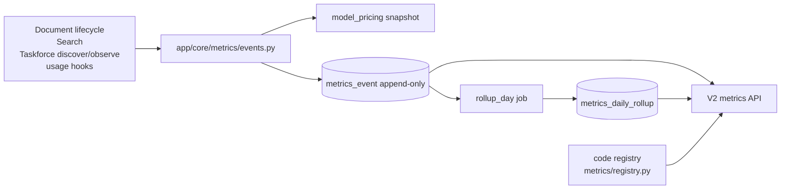

Metrics are event sourced. `metrics_event` is append-only and carries user, org, optional document, kind, token columns, USD, pricing snapshot, demo flag, and JSON payload.

Important event kinds:

- `document.created`, `document.updated`, `document.reused`, `document.finished`
- `document.consulted`
- `tokens.consumed`
- `tokens.saved.cache`, `tokens.saved.summary_only`, `tokens.saved.reuse`
- `taskforce.observed`

The registry in `app/core/metrics/registry.py` defines the public metrics without adding tables per metric. Current metrics include tokens saved, USD saved, tokens used, USD spent, documents touched, reuse rate, documents consulted, avoided rediscovery, and avoided rediscovery USD.

## Billing And Tiers

Stripe state is stored on `User` and interpreted by `app/core/tiering.py`.

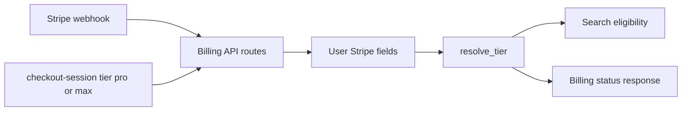

The billing API supports subscription checkout, price changes, portal sessions, Stripe webhooks, and status. Search is the first feature using explicit tier logic:

- `free`: no V2 Search.
- `pro`: BYOK required for Search.
- `max` and `admin`: managed Search.

## Hosted MCP Bridge

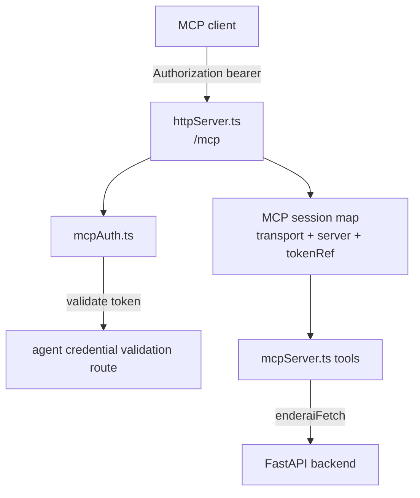

The MCP bridge exposes both old `enderai_*` tools and new `taskforce_*` tools. The hosted HTTP server validates the incoming bearer token once per request, binds a per-user backend token to the MCP session, and forwards API calls through `enderaiFetch()`.

Primary tool groups:

- New Taskforce session tools: `taskforce_session_start`, `taskforce_session_observe`, `taskforce_session_log`, `taskforce_discover`.
- V2 document lifecycle tools: `enderai_begin_document`, `enderai_update_document`, `enderai_finish_document`.
- Legacy Topic/Case tools: `enderai_begin_case`, `enderai_update_case`, `enderai_use_skill`, `enderai_finish_case`.
- Diagnostics / escape hatches: `enderai_session_info`, `enderai_request`, `enderai_openapi`, `enderai_health_check`.

## Legacy V1 Model

The legacy V1 model remains active for fallback and compatibility:

- `Topic`: reusable area of work with rollup intelligence.
- `CaseRecord`: bounded work session under a Topic.
- `CaseEvent`: append-only timeline for case progress.
- `ContextPack`: synthesized hydration snapshot built from Topics and prior Cases.
- `Skill`: generated reusable workflow instructions based on Topics/Cases/ContextPacks.

These are still available through `/topics`, `/cases`, `/context-packs/build`, `/skills`, and the legacy MCP tools. New backend work should assume V2 documents and Taskforce sessions are the primary path unless the caller is explicitly V1-only.

## Operational Notes And Risks

- The search indexer currently runs as an in-process FastAPI lifespan task. If multiple backend instances run the same sweeper, the planned next step is a Postgres advisory lock.
- Search indexing currently covers V2 documents only. The connector abstraction is ready for Slack/GitHub/Gmail/GDocs, but those are not active sources in this code.
- Observation is shadow-mode by default. That is intentional for rollout safety, but it means observe calls may record metrics without mutating documents until the env flag changes.
- Org-scope metrics are gated to admins, but the current read path still computes personal metrics; org fan-out is called out in code as follow-up work.
- Product naming is mid-migration. Runtime service names, package names, route names, and env vars still say `enderai` in many places.

## File Map

```text
taskforce-claude/
|-- render.yaml
|-- demo/full-stack-fastapi-template/backend/
|   |-- app/main.py
|   |-- app/api/main.py
|   |-- app/api/deps.py
|   |-- app/models.py
|   |-- app/api/routes/
|   |   |-- v2_documents.py
|   |   |-- taskforce.py
|   |   |-- v2_search.py
|   |   |-- v2_byok.py
|   |   |-- v2_metrics.py
|   |   |-- agent_credentials.py
|   |   |-- billing.py
|   |   |-- topics.py
|   |   |-- cases.py
|   |   `-- skills.py
|   |-- app/core/
|   |   |-- v2_documents.py
|   |   |-- taskforce/
|   |   |-- search/
|   |   |-- metrics/
|   |   |-- tiering.py
|   |   |-- stripe_billing.py
|   |   |-- firebase_auth.py
|   |   `-- topics.py / cases.py / skills.py
|   `-- app/alembic/versions/
`-- mcp/enderai-api-mcp/
    |-- src/httpServer.ts
    |-- src/mcpAuth.ts
    |-- src/mcpServer.ts
    |-- src/taskforce/
    `-- src/v2Documents/
```
