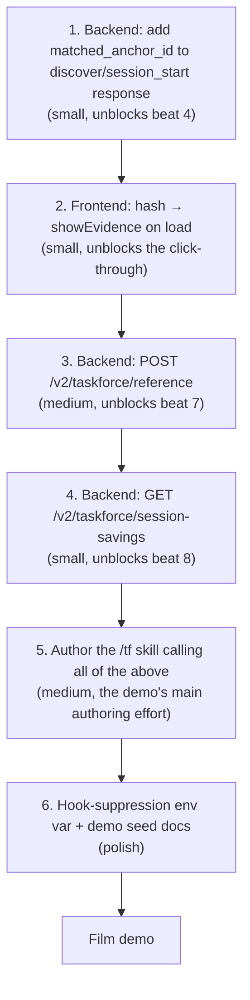

# `/tf` skill demo — story → build plan

Last updated: 2026-05-23

This is the canvas plan for the user-flow demo. Each row is one beat of the story; the columns show what already exists, what's missing, and where the missing piece lives.

## Story beats (the script we're filming)

```text
[1] User in Claude Code types:
    "there's a signal connection missing on the signal_creation page"

[2] User invokes /tf  →  activates the Taskforce skill.

[3] Claude says: "Let me check Taskforce…"
    Shows the payload being sent to the Taskforce backend
    (prompt + cwd + files + git_branch — NOT the scoring internals).

[4] Claude returns:
    "I got the following related context from Taskforce:
       1. Document A — signal_creation page issues       [LINK + #anchor]
       2. Document B — debugging signal_creation         [LINK + #anchor]"
    Each link opens the V2 doc viewer, scrolled to the anchor the
    match came from. User can verify the source themselves.

[5] Claude: "Auto-injecting the context…"
    Reads the relevant anchors into its working context.

[6] Claude does the work (edits, tests, etc).

[7] Each consulted doc gets a new 'Referenced by:' entry appended:
    {session_id, timestamp, user, brief context of the request}.

[8] Claude: "Finished. Taskforce saved you 4.2k tokens on
    Opus 4.7 xhigh effort (approx. $0.42 USD)."
```

## Beat-by-beat build matrix

| # | Beat | Backend | MCP | Skill / Hook | Frontend | Status |
|---|---|---|---|---|---|---|
| 1 | User types prompt | — | — | — | — | n/a |
| 2 | `/tf` invocation | — | — | **NEW SKILL** | — | **MISSING** |
| 3 | "Let me check Taskforce…" + payload display | `POST /v2/taskforce/discover` ✅ | — | skill must format + show payload | — | backend ✅, skill behavior **MISSING** |
| 4 | Match list with deep-link anchors | discover returns `document_id` + `summary_markdown` ✅; **anchor_id NOT returned** | — | skill renders markdown links | doc viewer at `/v2/library/$documentId` exists ✅; **`#anchor` deep-link on load NOT wired** | **PARTIAL** |
| 5 | Auto-injecting context | hook already prepends preamble (silent) ✅ | — | skill needs to *announce* it + optionally fetch full anchor body via `GET /v2/documents/{id}` ✅ | — | covered by skill logic |
| 6 | Claude does the work | — | — | normal agent | — | ✅ |
| 7 | Append "Referenced by:" entries to consulted docs | **NEW**: needs a doc-side append endpoint or extension of `/observe` | — | skill calls it on completion | viewer must render the section ✅ (Details markdown already supports arbitrary sections) | **MISSING (backend + skill)** |
| 8 | Final savings summary | `record_document_consulted` stores `net_saved_tokens` per consult ✅; `GET /v2/taskforce/session-log` returns per-session list ✅; **no aggregate-+-USD endpoint** | — | skill formats the message | — | **PARTIAL (backend aggregate missing)** |

## What's already built (verified)

**Backend** — `taskforce-claude/demo/full-stack-fastapi-template/backend/`:
- `POST /api/v1/v2/taskforce/discover` returns top-K matches with `document_id`, `title`, `score`, `confidence_band`, `match_reasons`, `summary_markdown`, `rediscovery_cost_tokens`, `consult_token_cost`. Records `document.consulted` metric per match.
- `POST /api/v1/v2/taskforce/session/start` (TF-181) — same as discover but also mints a `session_id` and may return a `suggested_pin`.
- `POST /api/v1/v2/taskforce/observe` — Haiku-summarizes a transcript and patches the active doc. **Shadow mode is on by default** (`TASKFORCE_OBSERVE_SHADOW=1`).
- `GET /api/v1/v2/taskforce/session-log?session_id=...` — returns per-session list of consults with `net_saved_tokens`.
- `GET /api/v1/v2/documents/{id}` — full doc read, ACL-checked. Returns `details_markdown_sections[]` keyed by `anchor_id`.
- `PATCH /api/v1/v2/documents/{id}` — `apply_v2_document_update` accepts `details_markdown_sections` and re-runs `refresh_v2_document_token_counts`.
- Pricing-aware net-savings math: `discover.py` writes `input_tokens = max(0, rediscovery_cost - summary_tokens)` onto each `document.consulted` event, priced at the snapshot effective at that moment.

**Frontend** — `EnderAI-frontend/`:
- `/v2/library/$documentId` route renders Summary + Details; `showEvidence(anchorId)` scrolls via `getElementById(anchorId).scrollIntoView()` (`library.$documentId.tsx:617-625`). Confirmed in code.
- Search citations chip uses `{source_item_id, chunk_anchor_id, url_path}` — the same shape the demo's discover links will need.

**Hooks** (currently installed on Alex's box, `~/.claude/hooks/taskforce-*`):
- `taskforce-user-prompt-submit.sh` already calls `/discover` on every prompt and prepends a "Related prior work" preamble. **This will fire alongside the `/tf` skill** unless we suppress one of them for the demo — see Open Q1.
- `taskforce-post-tool-use.sh` ticks a checkpoint counter.
- `taskforce-stop.sh` fires a `/observe` at session end.

**MCP** — `mcp/enderai-api-mcp/`:
- `taskforce_session_start`, `taskforce_session_observe`, `taskforce_session_log`, `taskforce_discover` tools already wired (TS clients in `src/taskforce/`).

## What's missing

**Tier 1 — required for the demo to film at all:**

1. **The `/tf` skill itself.** No `~/.claude/skills/tf*` or `~/.claude/commands/tf*` exists today. The skill must:
   - Read the user's latest prompt + cwd + git branch.
   - Show the payload it's about to POST (one short fenced block).
   - Call `POST /v2/taskforce/session/start` (preferred over `/discover` because it mints the `session_id` we need for beats 7 & 8).
   - Render matches as `[Title](https://www.taskforce.tools/v2/library/<id>#<anchor>)` links with the band + reason on the side.
   - Hand off the relevant anchor content to Claude's context (either inline-quote it or fetch `/v2/documents/{id}` and slice the section).
   - On completion, format and emit the final savings message (beat 8).

2. **Anchor on discover/session_start matches.** Today the response gives a flat `summary_markdown` but no anchor ID. For deep-linking to work, the backend needs to surface the *best anchor it scored against* (or default to `summary` when only the synthetic summary chunk matched). Minimum change: add `matched_anchor_id: str | None` to `TaskforceDiscoverMatch`. The scorer already knows which section markdown contributed; threading it through is small.

3. **Doc viewer reads `window.location.hash` on load.** `showEvidence(anchorId)` exists but is only called from in-page clicks. On first render the route should:
   ```ts
   useEffect(() => {
     const hash = window.location.hash.slice(1)
     if (hash) showEvidence(hash)
   }, [document?.id])
   ```
   Place this after the doc data loads so the element exists when scrolled to.

4. **"Referenced by:" append endpoint.** Two options:
   - **Cleanest:** new route `POST /v2/taskforce/reference` that takes `{session_id, document_ids[], user_prompt, occurred_at}` and appends a structured entry to each doc. Server-side it would either (a) append to a dedicated `referenced_by` JSONB column on `V2Document` (new column, new alembic migration), or (b) upsert a single details section with `anchor_id="referenced-by"` containing a markdown list. Option (b) is faster to ship and reuses the existing render path.
   - **Cheap:** the skill PATCHes each doc directly with an updated `details_markdown_sections` that includes a `referenced-by` section. Risk: race conditions with concurrent edits + the agent has to read-modify-write per doc.
   Recommend (a)-as-(b): new endpoint, but under the hood it just patches a `referenced-by` section. One transaction per doc, server handles the merge.

5. **Per-session savings aggregate endpoint.** Add `GET /v2/taskforce/session-savings?session_id=...` returning `{net_saved_tokens, usd_saved, doc_count, pricing_model}`. Backend already has all the raw numbers in `metrics_event`; this is a small `SUM(input_tokens), SUM(usd_amount) WHERE kind='document.consulted' AND payload->>'session_id'=?` query. Saves the skill from having to fetch the session log and re-sum it.

**Tier 2 — polish but not blocking:**

6. **Suppress the hook during `/tf` demo.** When the skill is invoked the hook would also fire on the same prompt → double consult events + double preamble. Either disable the hook for the demo session (`TASKFORCE_HOOKS_DISABLED=1` env var the hook script reads) or have the skill detect the hook's preamble and skip discovery.

7. **Model + effort detection in the savings line.** Beat 8 says "Opus 4.7 xhigh effort." The skill knows the model via `$CLAUDE_MODEL` / harness env; it should pass `pricing_model_id` to the session-savings call so the USD is computed against the model the user is actually paying for, not the default `claude-opus-4-7`.

8. **Demo seed.** Need two documents in Alex's library titled along the lines of "signal_creation page issues" and "debugging signal_creation" with enough content that the scorer fires on the user's prompt. Could be hand-crafted or seeded into the demo catalog.

## Suggested implementation order



## Open questions for Alex

1. **Hook + skill coexistence.** Do we want the hook *off* during the demo (so /tf is the only path that fires), or do we want to leave it on and show both? My recommendation: kill the hook for the demo session via env var; the demo's whole point is explicit, visible invocation.
2. **Inline anchor quote vs. context fetch.** When Claude "auto-injects context," should the skill quote the anchor *inline* in the chat (visible to the user) or fetch it silently into Claude's context buffer? Inline is more impressive visually; silent is closer to how the prod hook works today.
3. **`Referenced by:` storage.** Dedicated JSONB column on `V2Document` (cleaner long-term) vs. a managed `referenced-by` details section (ships faster, reuses existing render path)? My recommendation: ship the section approach first; promote to a column if/when we need to query "every doc this user was referenced by."
4. **Savings model assumption.** When the skill announces "Opus 4.7 xhigh effort," should that always show the model the user is *currently* on, or should we pin "Opus 4.7" for the demo regardless? Pinning makes the demo reproducible; dynamic looks more honest.
5. **Filming setup.** Are we filming against prod (`enderai-backend.onrender.com`) or a local stack? Anchor-on-load + the new endpoints would need to be live wherever we're pointing.

## Files most likely to touch

```text
Backend:
  app/api/routes/taskforce.py            ← add /reference, /session-savings
  app/core/taskforce/discover.py         ← thread matched_anchor_id through
  app/core/taskforce/scoring.py          ← return which anchor contributed
  app/models.py                          ← add matched_anchor_id field, request/response models
  app/alembic/versions/<new>_referenced_by.py  ← only if going column route

Frontend:
  src/routes/v2/library.$documentId.tsx  ← hash → showEvidence on load

Skill (new):
  ~/.claude/skills/tf/SKILL.md           ← skill prompt
  ~/.claude/skills/tf/tf.sh              ← bash/Python helper that calls the API
                                           and formats matches/savings

Hook (existing, optional tweak):
  scripts/taskforce-hooks/user-prompt-submit.sh
                                         ← honor TASKFORCE_HOOKS_DISABLED env
```
