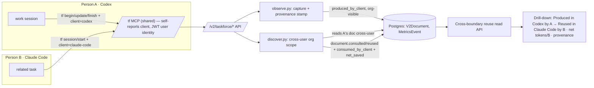

# Taskforce — Empty-Cell Proof: Build Design

*Approved build design (2026-05-31). Derived from `thesis.md` Addendum D and `taskforce-north-star-and-proof-plan.md`. This is the agent-facing spec — components are independently implementable, reviewable, and assignable.*

## Context

**Why this exists.** The thesis concluded that Taskforce's moat is the **cross-vendor + cross-person reuse-ROI ledger** — "the company brain." The single thing that proves the moat is one **auditable cross-boundary reuse event**: knowledge a teammate's agent figured out in *one tool* surfaces and is reused by another teammate's agent in a *different tool*, warm, with provenance, counted in the ledger. No competitor can structurally show this. The job of this build is to make **one such event real** (not seeded) and **clickable**, usable by alpha testers today and demoable to VCs.

**What's already built.** The capture→store→hydrate→ledger pipeline exists end-to-end for V2 documents. This build is *additive*. Two real gaps remain: (1) **origin-tool provenance** (which harness produced/reused), and (2) making the demo run **cross-user** (org-visible, non-demo). The rest is plumbing + a drill-down view + branding.

**Decisions baked in** (flag if wrong):
- Harnesses: **Codex + Claude Code** (fall back to Cursor if Codex is thin).
- Atom = **surfaced + used + provenance**; drop "confirmed" for now.
- One shared MCP; **agent self-reports its origin tool**; per-user **JWT identity**.
- $ savings shown but **not loudly labeled "estimated."**
- Profiles **seeded** for the demo, but **architect for v2 earned profiles**.
- Same repo, **two users, same org**.

---

## Current-state map (what already exists — do NOT rebuild)

Backend: `EnderAI/demo/full-stack-fastapi-template/backend/app/`.

| Capability | Where | Notes |
|---|---|---|
| MCP capture lifecycle | `mcp/enderai-api-mcp/` | `enderai_begin/update/finish_document` (+ legacy case tools), streamable HTTP, single bearer token. **Tier-3 `taskforce-cli`** for hookless harnesses (Codex/Cursor). |
| Session entry (Tier 2) | `core/taskforce/session.py` | `session_start` → mints `session_id`, routes specialist, runs discover. `POST /v2/taskforce/session/start`. |
| Discovery / rediscovery | `core/taskforce/discover.py` + `scoring.py` | Scores library vs request; emits `document.consulted` per match w/ `net_saved_tokens`. Candidate scope = `list_v2_documents_for_actor`. |
| Observation (capture) | `core/taskforce/observe.py` | Materiality → haiku summarizer (or Tier-2 structured fields) → patch/create doc → metrics. `POST /v2/taskforce/observe`. **Shadow mode default ON** (`TASKFORCE_OBSERVE_SHADOW=1`). |
| Secret scrub | `core/taskforce/redaction.py` | Boundary scrub. |
| Ledger / metrics | `core/metrics/events.py`, `savings.py`, `pricing.py`, `queries.py` | Real events: `document.consulted/reused/created/updated/finished`, `tokens.saved.reuse/cache/summary_only`, priced `usd_amount`. Emitters never commit. |
| Specialist routing (profiles) | `core/agents/routing.py` (`route_specialist`), `core/agents/seed.py`, `scripts/seed_agents.py` | `AgentSpecialist` + `AgentSpecialistDocumentLink`; slug threaded onto events. **Currently seeded (TF-198).** |
| Cross-user visibility | `core/v2_documents.py:3502` `list_v2_documents_for_actor` | Returns `owner==actor` **OR** (`visibility=="organization"` AND same org). **Self-only when `demo=True` or no org.** |
| Org model | `models.py` `Organization`, `User.organization_id`, `visibility: private\|organization` | On `V2Document`, `MetricsEvent`, `AgentSpecialist`. |
| Read APIs | `api/routes/taskforce.py` (`/session-log`, `/session-savings`, `/reference`), `agents.py`, `v2_metrics.py` | `/reference` already appends a "referenced-by" provenance row. |
| Frontend | `EnderAI-frontend/src/routes/v2/*`, `components/V2/{Agents,Metrics}` | TanStack Router; `agents.$slug`, `metrics`. |

---

## Architecture (target state)



```
  [A: Codex] --produce--> (V2Document, owner=A, produced_by_client=codex, visibility=organization)
                                   |
                                   v   cross-user org scope + congruence match
  [B: Claude Code] --discover--> document.consulted{ user_id=B, consumed_by_client=claude-code,
                                                     net_saved_tokens=N, specialist_slug=payments }
                                   |
                                   v
            DRILL-DOWN: "Produced in Codex by Alice · Reused in Claude Code by Bob · ~N tok / $Y"
```

---

## Components

### C1 — Origin-tool provenance (`client`) — the core gap
Every capture and reuse event records *which harness* it came from.
- **Models** (`models.py`): add `client: str | None` (`"claude-code"|"codex"|"cursor"`, ≤32) to `TaskforceDiscoverRequest`, `TaskforceSessionStartRequest`, `TaskforceObserveRequest`. Add `produced_by_client: str | None` to `V2Document` (+ Alembic migration, nullable).
- **Capture stamp** (`core/taskforce/observe.py::_create_document_from_summary`): set `produced_by_client = request.client`.
- **Reuse stamp** (`core/metrics/events.py::record_document_consulted` / `record_document_reused`): add `consumed_by_client` to `payload` (JSONB — no migration). Thread `client` through `discover.py::discover` and `session.py::session_start`.
- **Self-report**: agent passes `client` per call (via the `tf` skill / AGENTS.md). Advisory provenance, not auth.
- **Acceptance:** real discover from Claude Code against a Codex-produced doc → `document.consulted` row with `consumed_by_client="claude-code"`; doc has `produced_by_client="codex"`.

### C2 — Cross-user / org hydration for the demo
B's discover actually surfaces A's doc.
- Produced docs must be **org-visible**: add optional `visibility` to the observe/finish path (default stays `private`; scenario sets `"organization"`). File: `core/taskforce/observe.py::_create_document_from_summary` (hardcodes `private` today).
- Run **non-demo** (org-sharing disabled when `demo=True`). Both users share `organization_id`.
- **Verify** `core/agents/routing.py::route_specialist` candidate scope includes cross-user org docs (discover already does).
- **Acceptance:** A+B in one org, A's doc `organization`-visible → B's `session/start` returns A's doc in `matches`.

### C3 — Cross-boundary reuse read API + drill-down view — the demo deliverable
The single clickable artifact a skeptic verifies.
- **Read API** (extend `api/routes/taskforce.py` or `v2_metrics.py`): `GET /v2/taskforce/cross-boundary-reuse` → reuse/consult events where `event.user_id != document.owner_id`, joined to `produced_by_client` + `consumed_by_client`, with `net_saved_tokens`, `usd_amount`, `specialist_slug`, timestamps, both display names. Org-scoped.
- **UI** (`components/V2/...` + a route): a card rendering ONE event — *"Produced in Codex by Alice · Reused in Claude Code by Bob · ~N tokens / $Y"* + provenance trail (doc link, sessions, match reasons). Proven vs estimated split, **understated**.
- **Acceptance:** view shows the real C1/C2 event, drillable; nothing seeded in this card.

### C4 — `tf` MCP surface + client self-report (parallelizable, not on critical path)
- Rename `enderai_*` → `tf_*` (alias old during transition); Taskforce-branded. Files: `mcp/enderai-api-mcp/*`.
- Each tool/skill self-reports `client` (Claude Code via skill; Codex via `taskforce-cli --client codex`).
- Per-user **JWT** stays the identity; confirm it carries `user` + `organization_id`.
- **Acceptance:** both harnesses drive the lifecycle through one MCP, each self-identifying `client`.

### C5 — Demo scenario seed + runbook
- Seed org `Acme`, users **Alice** + **Bob** (same org); seeded **Payments AgentSpecialist** linked to Alice's *real* produced doc. Files: `scripts/seed_agents.py`, `core/agents/seed.py`, + a one-shot scenario script under `app/scripts/`.
- Content tuned so congruence matches: Alice's "Stripe webhook idempotency" ↔ Bob's "refund webhook".
- **Acceptance:** runbook from clean produces the C3 event deterministically.

### C6 — v2 earned profiles (architect now, build later)
- Design only: a specialist that **auto-accretes** `AgentSpecialistDocumentLink`s as org docs matching its routing signals accumulate (compounded from real cases, not seeded). Note the seam in `core/agents/routing.py` + a future `compound_specialist()` job.
- **Acceptance:** design note + TODO marker; no behavior change.

---

## Sequencing
1. **C1 + C2** (backend spine — unblocks everything).
2. **C5** (seed/runbook — depends on C1/C2).
3. **C3** (read API + view — depends on C1/C2; UI shell can start in parallel).
4. **C4** (branding/MCP — parallel track).
5. **C6** (design note — anytime).

## Verification (end-to-end)
1. Seed org + Alice/Bob; confirm shared `organization_id`.
2. As **Alice in Codex** (`taskforce-cli --client codex`): real session producing the idempotency doc; finish `organization`-visible. Confirm `produced_by_client="codex"`, `visibility="organization"`.
3. As **Bob in Claude Code**: `tf session/start` on refund-webhook (non-demo). Confirm Alice's doc in `matches`; `document.consulted` with `user_id=Bob`, `consumed_by_client="claude-code"`, `net_saved_tokens>0`, `specialist_slug="payments"`.
4. `GET /v2/taskforce/cross-boundary-reuse` returns that event; drill-down renders both clients + people + savings.
5. Negative: `TASKFORCE_OBSERVE_SHADOW=1` patches nothing; flip to `0` for live capture.
6. Backend tests by the changed modules; `npm test` in `mcp/` for C4.

## Risks / notes
- **Shadow mode** defaults ON — scenario must set `TASKFORCE_OBSERVE_SHADOW=0`.
- **`demo=True` disables cross-user** — proof runs non-demo; keep seeded *dashboard* demo data separate from this *real* event.
- **Provenance is advisory, not auth** — `client` is self-reported; hardening item.
- **"Used" is stubbed**: consult = "surfaced + looked at"; a stronger "incorporated" signal is deferred (ties to the metric-definitions work).
