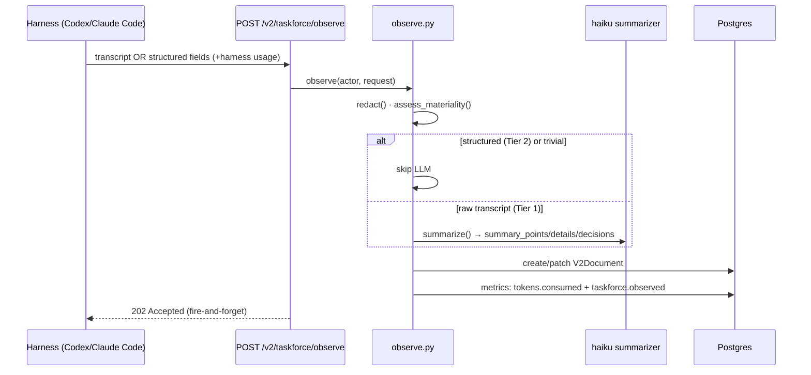
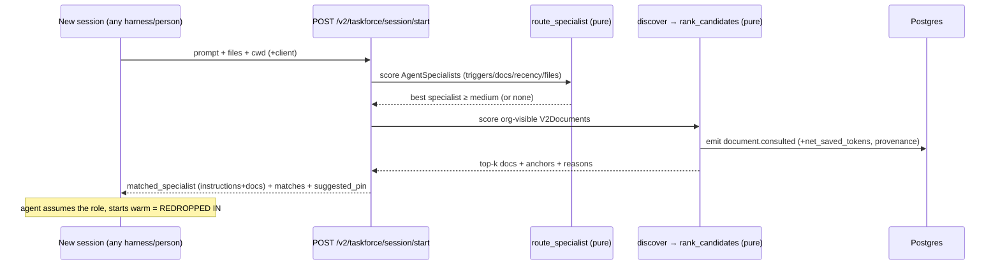

# Taskforce Pipeline — Deep Dive

> **The one-liner:** *raw input → clean agent profiles → redropped in.*
>
> This doc traces exactly how the codebase implements that loop, function by function — and **labels every part with a ▸ Grand scheme note** explaining what it's ultimately *for* in the thesis (the company brain · the moat = capture + seams + ledger · the confirmed-reuse "empty cell" · the curated-reuse flywheel). Backend root: `demo/full-stack-fastapi-template/backend/app/`. Companions: `../architecture-overview.md`, `taskforce-empty-cell-build-design.md`, `thesis.md` (Addendum D).

---

## The map

```
   RAW INPUT  ───────────────►  CLEAN PROFILES  ───────────────►  REDROPPED IN
 (capture, boundary)          (consolidate, offline)            (route + inject, boundary)

 harness hook / MCP / CLI      summarizer: transcript→doc        session/start → route_specialist
   POST /v2/taskforce/observe    (haiku, structured JSON)          → pick AgentSpecialist
   ├─ redact()  scrub secrets   V2Document  (the cleaned unit)    discover → rank_candidates
   ├─ assess_materiality()      AgentSpecialist  (the profile =   → top-k V2Documents + anchors
   ├─ summarize()  raw→clean      routing rules + instructions    → matched_specialist + linked docs
   └─ write V2Document            + curated linked docs)          → agent assumes role, starts warm
                                  created_from: seeded | earned   emits document.consulted/reused (ledger)
```

**▸ Grand scheme (the whole loop):** this *is* the non-parametric continual-learning layer. The model is frozen; the leverage is learning *between* sessions. The loop converts experience → reusable structure → warm starts, across tools and people. Owning this loop — not the model, not the harness — is the entire bet.

**The governing principle (thesis A3): in-loop = dumb & fast; out-of-loop = smart & slow.** The two things on the agent's critical path are a cheap **read** (route + discover, pure scoring, no LLM) and a cheap **append** (capture). All *intelligence* (summarizer, rediscovery-cost, profile consolidation, rollups) runs **off** the hot path; capture returns `202` so the agent never waits.
**▸ Grand scheme:** we are a **sensor, not a processor** — *present* at every harness's loop boundary but never computing there. That's what lets us sit inside tools we don't own without becoming one (and without becoming a latency tax). Latency is the forcing function that keeps us honest about staying a layer.

---

## Stage 1 — RAW INPUT (capture)

**Goal:** get what the agent just did into the store — scrubbed, curated, cheap — without slowing the agent.

**Entry points** (`api/routes/taskforce.py`, under `/v2/taskforce/`): **Tier 1 hooks** (PostToolUse `checkpoint` / Stop `final` → redacted transcript), **Tier 2 MCP/structured** (Codex/Cursor send `summary_points`/`details_sections`/`decisions`/`outcome`, skipping the LLM), **Tier 3 `taskforce-cli`** (hookless harnesses), plus the MCP doc lifecycle `enderai_begin/update/finish_document`.
**▸ Grand scheme — THE VENDOR SEAM.** Three tiers exist so we can be the **neutral capture sensor in *any* harness** — Claude Code, Cursor, Codex, a bare SDK script. This is the moat's ingestion layer and the seam no single lab will ever cross (no vendor curates context for a competitor's agent). Cross-vendor capture is *the* thing competitors are structurally barred from.

**The capture flow** — `core/taskforce/observe.py::observe`:
1. **Scrub at the boundary** — `redaction.py::redact`. Deterministic deny-list (env vars, `Authorization`, JWTs, `sk-ant-`/`sk-`/`ghp_`/`AKIA`/`xox` → `[REDACTED]`).
   **▸ Grand scheme:** trust is the precondition for a neutral third party touching an org's code (bear-case leg *c*). You can't un-leak — so we scrub *in-loop*, deterministically. Hygiene that protects the entire right to exist.
2. **Materiality gate** — `materiality.py::assess_materiality`. Pure; material iff ≥3 turns · ≥1 file · ≥2 distinct commands · or a pinned doc. Else skip the LLM.
   **▸ Grand scheme — FLYWHEEL DIRECTION.** The input must be *curated, reusable* knowledge, not raw exhaust. Uncurated, more use → more junk → worse retrieval → the wheel spins **backward**. This gate is the first curation valve that keeps the store a signal, not a landfill.
3. **The raw→clean transform** — `summarizer.py::summarize` (`claude-haiku-4-5`, `temp 0`, fixed prompt, JSON: `summary_points`/`details_sections`/`decisions`/`outcome`). Skipped when Tier-2 structured fields are present. Guarded by `max_tokens=1200` + **$1/user/day cap** + never-throws.
   **▸ Grand scheme — THIS IS THE LEARNING.** The non-parametric analog of a16z's "lossy compression is the learning." Turning raw experience into reusable structure is what makes us a *continual-learning* layer rather than a log store. (Table-stakes mechanism — do it well, don't *sell* it.)
4. **Write the cleaned unit** — patch/create the `V2Document`.
   **▸ Grand scheme — THE MOMENT SEAM.** Ephemeral session memory dies with the session; a written `V2Document` is the durable institutional record. It's the atom the ledger and the profiles are both built on.
5. **Meter it** — `tokens.consumed` (summarizer), `agent_session` (harness totals), `taskforce.observed` audit.
   **▸ Grand scheme:** even our *own* cost is on the ledger — credibility comes from metering everything (tokens prove).
6. **Shadow mode** — `TASKFORCE_OBSERVE_SHADOW=1` (default ON) audits intent without patching. ⚠️ Proof runs with it OFF.
   **▸ Grand scheme:** safe to run in production *before* we trust the writes — operational discipline so being-in-the-loop is never a liability.

**Output:** a `V2Document` (`title`, `ai_generated_summary`, `main_body`, anchored `details_markdown_sections`, `outcome`) — one messy session → one structured unit.



---

## Stage 2 — CLEAN AGENT PROFILES (consolidate)

Two arrows of "cleaning." The first is real; the second is the moat (and the seeded→earned gap).

### 2a. session → document  *(real)*
The summarizer (Stage 1) makes a structured doc. Each doc also caches a **value estimate** — `rediscovery.py::compute_rediscovery_cost` = `1500·commands + 2500·files + 500·decisions + 3000·details_sections + 1000·summary_points`, capped 50k.
**▸ Grand scheme — THE PROVEN BASE OF THE LEDGER.** This is the "what would re-deriving have cost" number. *Tokens prove, throughput prices* — this is the tokens-prove half: a mechanical, single-instance-auditable value attached to every cleaned doc, so reuse can be priced honestly.

### 2b. documents → profile  *(the moat; today **seeded**)*
A **profile** = `AgentSpecialist`: `instructions` (how to *be* the expert) + `routing_triggers`/`negative_triggers`/`domain_tags` (when to fire) + curated **`AgentSpecialistDocumentLink`** rows (the cleaned docs that back it, with `weight`/`anchor_id`/`reason`/`is_pinned`). Provenance = **`created_from`** (default **`"seeded"`**). Today inserted by hand (`core/agents/seed.py`, TF-198). The arrow that compounds real docs into a profile — `created_from:"earned"` — is **unbuilt (C6/TF-205)**.
**▸ Grand scheme — THE HERO NOUN.** This is "the company brain" at its richest granularity: a compounding expert that crosses people and tools — *memory shaped like an expert.* The discipline (thesis D5): a profile is a **substrate a harness consumes**, never an orchestrator that runs agents (that path = Identity A = becoming Letta = forfeiting neutrality). **Earned vs seeded is the moat line:** earned = *what your agents figure out, not what you write down* (the thing AGENTS.md structurally can't be); seeded is a demo prop. C6 turns this arrow from prop into moat.

---

## Stage 3 — REDROPPED IN (route + inject)

**Goal:** on any new session (any tool, any teammate), pick the right profile + docs and hand them back warm — pure, fast, no LLM.

**Entry:** `POST /v2/taskforce/session/start` (`session.py::session_start`), `/discover`, or MCP `enderai_begin_document`.

1. **Route to a profile** — `core/agents/routing.py::route_specialist` (pure):
   `score = 0.45·trigger_overlap + 0.35·linked_doc_match + 0.10·recency + 0.10·file_overlap`; `negative_triggers` > 0.5 vetoes; bands high ≥ .65 / medium ≥ .40; `None` below medium.
   **▸ Grand scheme — "BRING IT BACK AT THE RIGHT TIME."** Precision here = injection correctness (thesis A5): a *plausibly-wrong* profile is worse than cold (the agent anchors and goes confidently wrong). The negative-trigger veto exists precisely to suppress malignant false positives. Right expertise, right moment, or stay silent.
2. **Find the docs** — `discover.py::discover` over `list_v2_documents_for_actor` (self **+ org-visible**) via `scoring.py::rank_candidates`: `0.30·title + 0.25·corpus + 0.15·files + 0.10·symbols + 0.05·errors + 0.15·recency`, top-3 with anchors + reasons.
   **▸ Grand scheme — THE DEV VALUE / FAST LOOP.** This is the warm start that *stops re-deriving solved work* — the felt value that drives adoption and feeds the product loop (events → better retrieval → more use). `list_v2_documents_for_actor` returning **org-visible** docs is the **person seam**: my-machine memory ≠ the team's shared knowledge.
3. **Meter the redrop (THE LEDGER ATOM)** — every match → `record_document_consulted` with `net_saved_tokens = max(0, rediscovery_cost − summary_tokens_read)`, priced, tagged `session_id` + `specialist_slug` (+ `consumed_by_client` after C1). Stronger atom: `record_document_reused`.
   **▸ Grand scheme — THE EMPTY CELL.** This event is the *confirmed-reuse atom* — the one number no single vendor can structurally show: produced in tool X by person P, reused in tool Y by person Q, with provenance and a cost. Every metric is a view of this. The cross-boundary cut (C1/C2/C3) is the procurement wedge and the category we own.
4. **Hand it back** — `matched_specialist` (slug/role/**instructions**/linked docs + deep links) + `matches` + `suggested_pin`. The agent assumes the role and starts warm.
   **▸ Grand scheme — SUBSTRATE, NOT ORCHESTRATOR.** We *supply the expert context*; the user's own harness runs the agent. This is the line that keeps us neutral and off the Cursor/Letta/Devin rock — we sit *across* the tools; they want to *be* one.



---

## The value view (ledger) — a read over the same events

`core/metrics/`: `events.py` writes the atoms; `savings.py`/`pricing.py` price them; `queries.py`/`rollup.py`/`registry.py` aggregate. Cross-boundary provenance is derivable today (doc.`owner_id` = producer, event.`user_id` = consumer); C1 adds the *tool* dimension; C3 renders one event end-to-end.
**▸ Grand scheme — THE COMMERCIAL LOOP / THE MOAT'S THIRD LEG.** *Tokens prove, throughput prices.* This is the **neutral ROI ledger** a vendor will never build (it would be telling you to buy less of them). It funds the champion → check-writer handoff. The dev never has to see it; the buyer never has to touch the memory — each persona on their own surface, one shared substrate underneath.

---

## In-loop vs out-of-loop (where each piece runs, and why)

| In-loop / boundary (dumb, fast, deterministic) | Out-of-loop (smart, slow, offline) |
|---|---|
| `redaction.redact` · `materiality.assess_materiality` | `summarizer.summarize` (raw→clean) |
| `routing.route_specialist` · `scoring.rank_candidates` | `rediscovery.compute_rediscovery_cost` |
| capture append (`/observe`, 202) | `metrics/{rollup,queries}` · **earned-profile consolidation (C6)** |

**▸ Grand scheme:** the split *is* the architecture of "sensor not processor." Anything that must be fast + safe stays a deterministic boundary op; anything smart is deferred so we never pay to be intelligent on the agent's clock. This is what makes a neutral, cross-vendor, in-the-loop layer economically and latency-wise possible.

---

## Data model (the three nouns)

- **`V2Document`** — the cleaned unit / **moment seam**. `owner_id`·`organization_id`·`visibility`·`title`·`ai_generated_summary`·`main_body`·`details_markdown_sections`·`rediscovery_cost_tokens` *(+C1 `produced_by_client`)*.
- **`AgentSpecialist`** (+ `AgentSpecialistDocumentLink`) — the profile / **hero noun**. `instructions`+`routing/negative_triggers`+linked docs + **`created_from(seeded|earned)`**.
- **`MetricsEvent`** — the ledger / **empty-cell atom**. `kind`·`user_id`·`organization_id`·`document_id`·tokens·`usd_amount`·`payload`(`specialist_slug`,`session_id`,`net_saved_tokens` *,+C1 `consumed_by_client`*).

**▸ Grand scheme:** three nouns, three moat legs — the **record** (V2Document, durable across the moment seam), the **expert** (AgentSpecialist, compounding across the person seam), the **ledger** (MetricsEvent, priced across the vendor seam). The triad none of Mem0 / Letta / xMemory holds together.

---

## Where the one-liner is real vs seeded vs missing → TF-199

| One-liner stage | Status today | Gap → ticket |
|---|---|---|
| raw input → V2Document | ✅ real (hooks/MCP/CLI → observe → summarizer) | shadow-mode default ON (flip for proof) |
| V2Document → **profile** | ⚠️ **seeded** (`created_from:"seeded"`) | **C6 / TF-205** — earned-profile consolidation |
| redropped in (route+discover+inject) | ✅ real, single-user/single-tool | **C1** provenance · **C2** cross-user · **C3** drill-down |

The pipeline already *runs* the one-liner end-to-end for one user in one tool. TF-199 makes it **cross-vendor + cross-person** (C1/C2/C3) and flips the middle arrow **seeded → earned** (C6) — i.e. turns the mechanism we *have* into the moat we're *claiming*.

---

## File index (read in this order)
1. `api/routes/taskforce.py` — the HTTP surface
2. `core/taskforce/{redaction,materiality,summarizer,observe}.py` — Stage 1 (raw input)
3. `core/taskforce/rediscovery.py` + `models.py::AgentSpecialist*` + `core/agents/seed.py` — Stage 2 (clean)
4. `core/taskforce/{session,discover,scoring}.py` + `core/agents/{routing,access}.py` — Stage 3 (redrop)
5. `core/metrics/{events,savings,pricing,queries,rollup,registry}.py` — the ledger view
